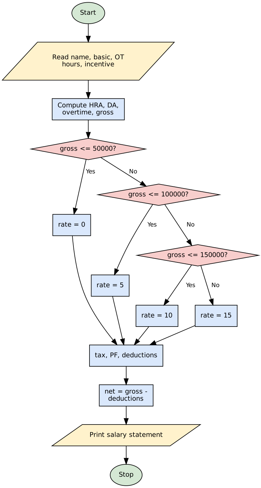
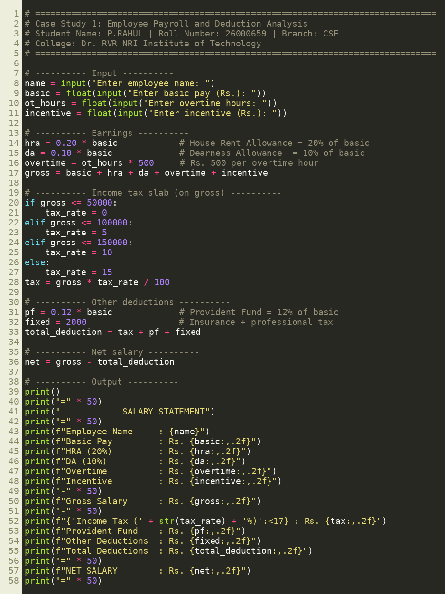
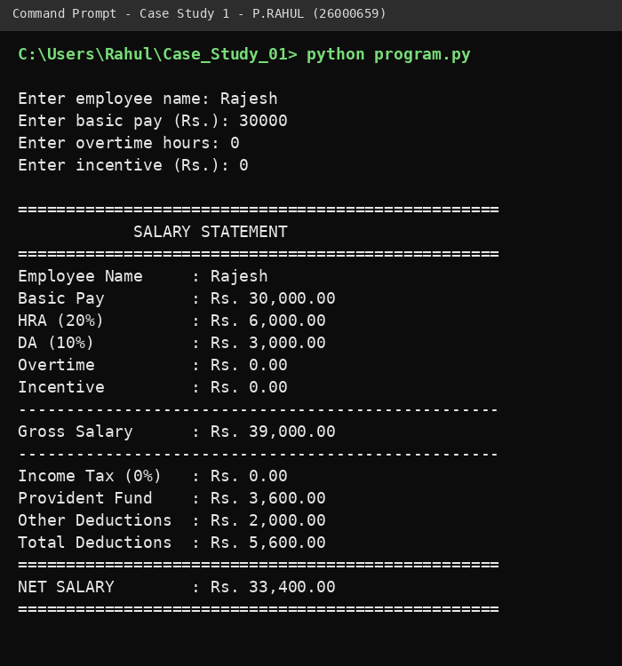

# Case Study 1: Employee Payroll and Deduction Analysis

**Student:** P.RAHUL | **Roll Number:** 26000659 | **Branch:** CSE | **College:** Dr. RVR NRI Institute of Technology

## 1. Problem Statement
A company must calculate each employee's monthly salary from basic pay, allowances, overtime and incentive, then subtract income tax, provident fund and fixed deductions. Doing this by hand is slow and error-prone, so a program should produce a correct salary statement automatically.

## 2. Objectives
- Read name, basic pay, overtime hours and incentive.
- Compute HRA (20%), DA (10%) and overtime pay (Rs. 500/hour).
- Find gross salary and apply the income-tax slab.
- Subtract PF (12% of basic) and fixed deductions (Rs. 2,000) to get net salary.

## 3. Assumptions and Rules
- HRA = 20% of basic; DA = 10% of basic; overtime = Rs. 500 per hour.
- Tax on gross: up to 50,000 -> 0%; up to 1,00,000 -> 5%; up to 1,50,000 -> 10%; above -> 15%.
- PF = 12% of basic; other deductions = Rs. 2,000 (fixed).

## 4. Input and Output
- **Input:** name (str), basic pay, overtime hours, incentive (float)
- **Output:** Itemised salary statement with gross, deductions and net salary

## 5. Algorithm
1. Start.
2. Read name, basic, overtime hours, incentive.
3. Compute hra, da, overtime and gross.
4. Choose tax rate using if-elif-else on gross; compute tax.
5. Compute pf and total deductions.
6. net = gross - total deductions.
7. Print the salary statement.
8. Stop.

## 6. Flowchart


## 7. Pseudocode
```text
START
  READ name, basic, ot_hours, incentive
  hra = 0.20*basic ; da = 0.10*basic ; overtime = ot_hours*500
  gross = basic + hra + da + overtime + incentive
  IF gross <= 50000 THEN rate = 0
  ELSE IF gross <= 100000 THEN rate = 5
  ELSE IF gross <= 150000 THEN rate = 10
  ELSE rate = 15
  tax = gross*rate/100 ; pf = 0.12*basic
  net = gross - (tax + pf + 2000)
  PRINT statement
STOP
```

## 8. Python Source Code


```python
# ==============================================================================
# Case Study 1: Employee Payroll and Deduction Analysis
# Student Name: P.RAHUL | Roll Number: 26000659 | Branch: CSE
# College: Dr. RVR NRI Institute of Technology
# ==============================================================================

# ---------- Input ----------
name = input("Enter employee name: ")
basic = float(input("Enter basic pay (Rs.): "))
ot_hours = float(input("Enter overtime hours: "))
incentive = float(input("Enter incentive (Rs.): "))

# ---------- Earnings ----------
hra = 0.20 * basic            # House Rent Allowance = 20% of basic
da = 0.10 * basic             # Dearness Allowance  = 10% of basic
overtime = ot_hours * 500     # Rs. 500 per overtime hour
gross = basic + hra + da + overtime + incentive

# ---------- Income tax slab (on gross) ----------
if gross <= 50000:
    tax_rate = 0
elif gross <= 100000:
    tax_rate = 5
elif gross <= 150000:
    tax_rate = 10
else:
    tax_rate = 15
tax = gross * tax_rate / 100

# ---------- Other deductions ----------
pf = 0.12 * basic             # Provident Fund = 12% of basic
fixed = 2000                  # Insurance + professional tax
total_deduction = tax + pf + fixed

# ---------- Net salary ----------
net = gross - total_deduction

# ---------- Output ----------
print()
print("=" * 50)
print("            SALARY STATEMENT")
print("=" * 50)
print(f"Employee Name     : {name}")
print(f"Basic Pay         : Rs. {basic:,.2f}")
print(f"HRA (20%)         : Rs. {hra:,.2f}")
print(f"DA (10%)          : Rs. {da:,.2f}")
print(f"Overtime          : Rs. {overtime:,.2f}")
print(f"Incentive         : Rs. {incentive:,.2f}")
print("-" * 50)
print(f"Gross Salary      : Rs. {gross:,.2f}")
print("-" * 50)
print(f"{'Income Tax (' + str(tax_rate) + '%)':<17} : Rs. {tax:,.2f}")
print(f"Provident Fund    : Rs. {pf:,.2f}")
print(f"Other Deductions  : Rs. {fixed:,.2f}")
print(f"Total Deductions  : Rs. {total_deduction:,.2f}")
print("=" * 50)
print(f"NET SALARY        : Rs. {net:,.2f}")
print("=" * 50)
```

## 9. Test Cases
Outputs below are from actually running `program.py`.

**Test 1 - 0% slab**

Input: `Rajesh | 30000 | 0 | 0`

```text
Enter employee name: Rajesh
Enter basic pay (Rs.): 30000
Enter overtime hours: 0
Enter incentive (Rs.): 0

==================================================
            SALARY STATEMENT
==================================================
Employee Name     : Rajesh
Basic Pay         : Rs. 30,000.00
HRA (20%)         : Rs. 6,000.00
DA (10%)          : Rs. 3,000.00
Overtime          : Rs. 0.00
Incentive         : Rs. 0.00
--------------------------------------------------
Gross Salary      : Rs. 39,000.00
--------------------------------------------------
Income Tax (0%)   : Rs. 0.00
Provident Fund    : Rs. 3,600.00
Other Deductions  : Rs. 2,000.00
Total Deductions  : Rs. 5,600.00
==================================================
NET SALARY        : Rs. 33,400.00
==================================================
```

**Test 2 - 5% slab**

Input: `Suresh | 50000 | 10 | 5000`

```text
Enter employee name: Suresh
Enter basic pay (Rs.): 50000
Enter overtime hours: 10
Enter incentive (Rs.): 5000

==================================================
            SALARY STATEMENT
==================================================
Employee Name     : Suresh
Basic Pay         : Rs. 50,000.00
HRA (20%)         : Rs. 10,000.00
DA (10%)          : Rs. 5,000.00
Overtime          : Rs. 5,000.00
Incentive         : Rs. 5,000.00
--------------------------------------------------
Gross Salary      : Rs. 75,000.00
--------------------------------------------------
Income Tax (5%)   : Rs. 3,750.00
Provident Fund    : Rs. 6,000.00
Other Deductions  : Rs. 2,000.00
Total Deductions  : Rs. 11,750.00
==================================================
NET SALARY        : Rs. 63,250.00
==================================================
```

**Test 3 - 15% slab**

Input: `Anita | 120000 | 20 | 10000`

```text
Enter employee name: Anita
Enter basic pay (Rs.): 120000
Enter overtime hours: 20
Enter incentive (Rs.): 10000

==================================================
            SALARY STATEMENT
==================================================
Employee Name     : Anita
Basic Pay         : Rs. 120,000.00
HRA (20%)         : Rs. 24,000.00
DA (10%)          : Rs. 12,000.00
Overtime          : Rs. 10,000.00
Incentive         : Rs. 10,000.00
--------------------------------------------------
Gross Salary      : Rs. 176,000.00
--------------------------------------------------
Income Tax (15%)  : Rs. 26,400.00
Provident Fund    : Rs. 14,400.00
Other Deductions  : Rs. 2,000.00
Total Deductions  : Rs. 42,800.00
==================================================
NET SALARY        : Rs. 133,200.00
==================================================
```

## 10. Program Execution and Output


Full execution log: `output.txt`.

## 11. Conclusion
The program turns salary rules into an if-elif-else ladder and shows how arithmetic operators and formatted f-strings produce a clear payslip.

## 12. Viva Questions
1. **Q: Why use if-elif-else for the tax slabs?**  
   A: The slabs are mutually exclusive, so the first true condition is chosen and the rest are skipped.
2. **Q: What does :,.2f do?**  
   A: It prints a float with comma separators and exactly two decimal places.
3. **Q: What if basic pay is negative?**  
   A: The program would still calculate but give a meaningless result; input validation (if basic < 0) should be added.
