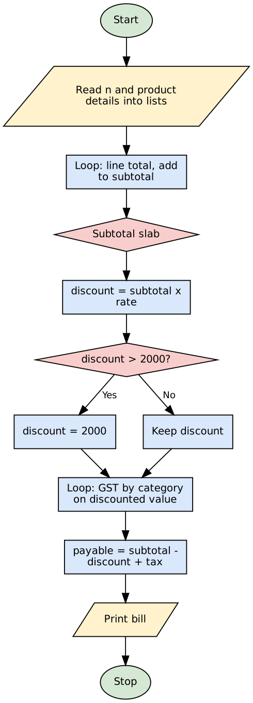
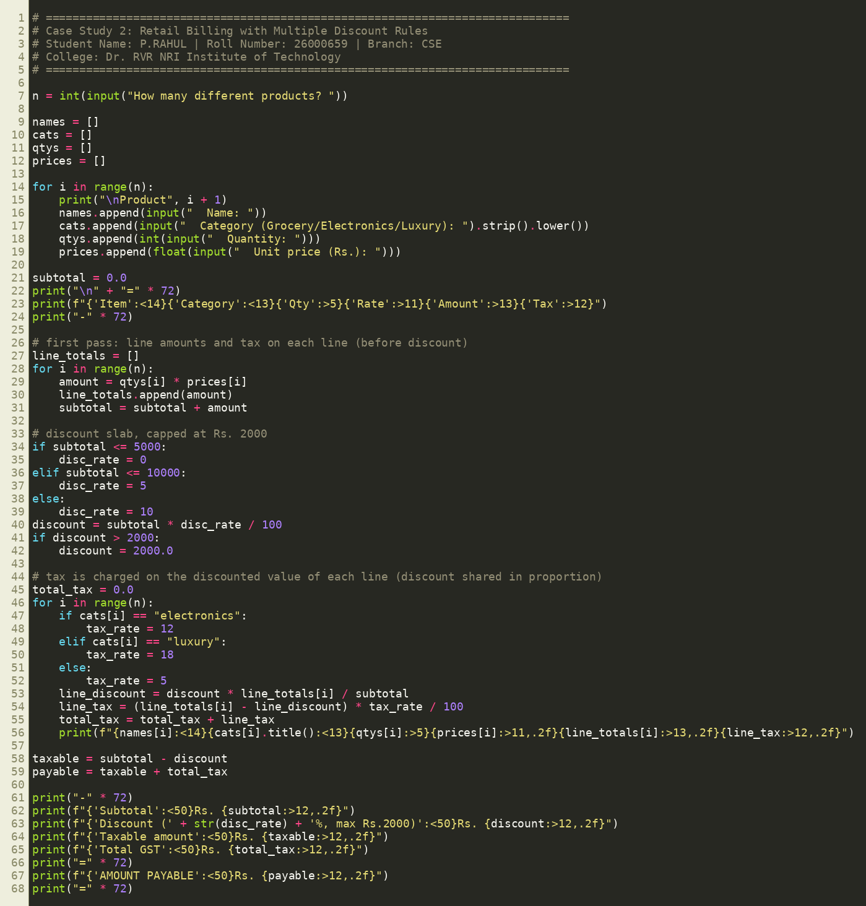
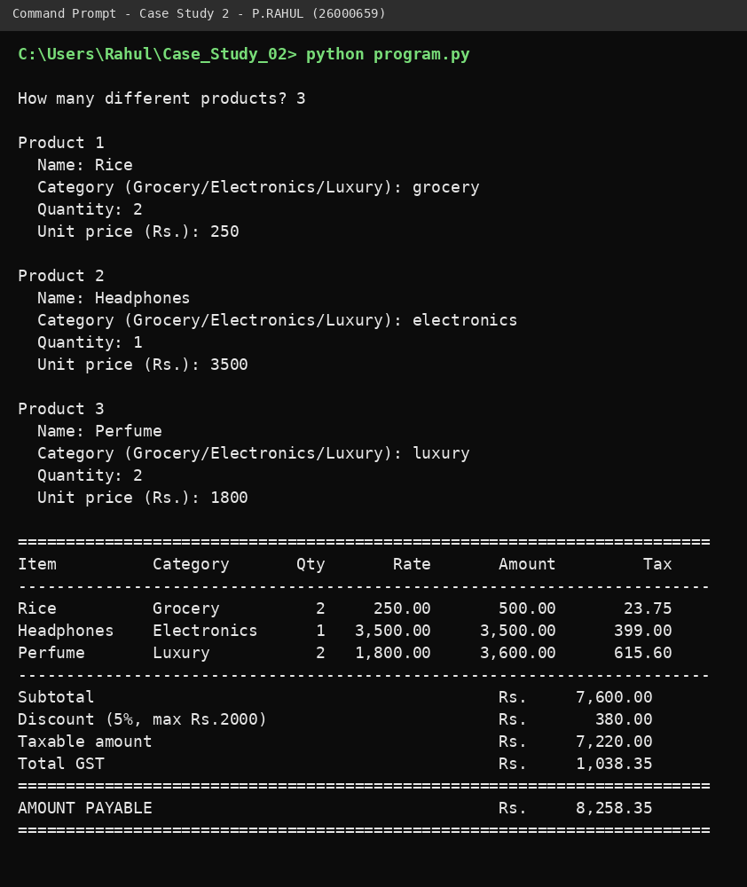

# Case Study 2: Retail Billing with Multiple Discount Rules

**Student:** P.RAHUL | **Roll Number:** 26000659 | **Branch:** CSE | **College:** Dr. RVR NRI Institute of Technology

## 1. Problem Statement
A shop sells items from different categories, each with its own GST rate. Large bills get a discount, but the discount is limited to a maximum amount. The program should create a correct itemised bill.

## 2. Objectives
- Read several products with category, quantity and price.
- Compute the subtotal.
- Apply the slab discount with a cap of Rs. 2,000.
- Apply category-wise GST and print the final payable amount.

## 3. Assumptions and Rules
- GST: Grocery 5%, Electronics 12%, Luxury 18% (any other category 5%).
- Discount: subtotal up to 5,000 -> 0%; up to 10,000 -> 5%; above -> 10%; maximum Rs. 2,000.
- The discount is shared across items in proportion to their amounts, and GST is charged on the discounted value of each item.

## 4. Input and Output
- **Input:** number of products; for each: name, category, quantity, unit price
- **Output:** Bill table with tax per item, subtotal, discount, GST and payable amount

## 5. Algorithm
1. Start.
2. Read n and then name, category, quantity, price for each product into lists.
3. Compute line totals and the subtotal.
4. Choose discount % from the slab; discount = subtotal x % / 100; if discount > 2000 set it to 2000.
5. For every item find the GST rate from its category and compute tax on the discounted line value.
6. payable = subtotal - discount + total tax.
7. Print the bill.
8. Stop.

## 6. Flowchart


## 7. Pseudocode
```text
START
  READ n
  FOR i = 1 TO n: READ name, cat, qty, price
  subtotal = SUM(qty*price)
  rate = 0 / 5 / 10 by subtotal slab
  discount = MIN(subtotal*rate/100, 2000)
  FOR each item: tax = (line - share of discount) * GSTrate(cat)
  payable = subtotal - discount + total tax
  PRINT bill
STOP
```

## 8. Python Source Code


```python
# ==============================================================================
# Case Study 2: Retail Billing with Multiple Discount Rules
# Student Name: P.RAHUL | Roll Number: 26000659 | Branch: CSE
# College: Dr. RVR NRI Institute of Technology
# ==============================================================================

n = int(input("How many different products? "))

names = []
cats = []
qtys = []
prices = []

for i in range(n):
    print("\nProduct", i + 1)
    names.append(input("  Name: "))
    cats.append(input("  Category (Grocery/Electronics/Luxury): ").strip().lower())
    qtys.append(int(input("  Quantity: ")))
    prices.append(float(input("  Unit price (Rs.): ")))

subtotal = 0.0
print("\n" + "=" * 72)
print(f"{'Item':<14}{'Category':<13}{'Qty':>5}{'Rate':>11}{'Amount':>13}{'Tax':>12}")
print("-" * 72)

# first pass: line amounts and tax on each line (before discount)
line_totals = []
for i in range(n):
    amount = qtys[i] * prices[i]
    line_totals.append(amount)
    subtotal = subtotal + amount

# discount slab, capped at Rs. 2000
if subtotal <= 5000:
    disc_rate = 0
elif subtotal <= 10000:
    disc_rate = 5
else:
    disc_rate = 10
discount = subtotal * disc_rate / 100
if discount > 2000:
    discount = 2000.0

# tax is charged on the discounted value of each line (discount shared in proportion)
total_tax = 0.0
for i in range(n):
    if cats[i] == "electronics":
        tax_rate = 12
    elif cats[i] == "luxury":
        tax_rate = 18
    else:
        tax_rate = 5
    line_discount = discount * line_totals[i] / subtotal
    line_tax = (line_totals[i] - line_discount) * tax_rate / 100
    total_tax = total_tax + line_tax
    print(f"{names[i]:<14}{cats[i].title():<13}{qtys[i]:>5}{prices[i]:>11,.2f}{line_totals[i]:>13,.2f}{line_tax:>12,.2f}")

taxable = subtotal - discount
payable = taxable + total_tax

print("-" * 72)
print(f"{'Subtotal':<50}Rs. {subtotal:>12,.2f}")
print(f"{'Discount (' + str(disc_rate) + '%, max Rs.2000)':<50}Rs. {discount:>12,.2f}")
print(f"{'Taxable amount':<50}Rs. {taxable:>12,.2f}")
print(f"{'Total GST':<50}Rs. {total_tax:>12,.2f}")
print("=" * 72)
print(f"{'AMOUNT PAYABLE':<50}Rs. {payable:>12,.2f}")
print("=" * 72)
```

## 9. Test Cases
Outputs below are from actually running `program.py`.

**Test 1 - Mid bill (5% discount)**

Input: `3 | Rice | grocery | 2 | 250 | Headphones | electronics | 1 | 3500 | Perfume | luxury | 2 | 1800`

```text
How many different products? 3

Product 1
  Name: Rice
  Category (Grocery/Electronics/Luxury): grocery
  Quantity: 2
  Unit price (Rs.): 250

Product 2
  Name: Headphones
  Category (Grocery/Electronics/Luxury): electronics
  Quantity: 1
  Unit price (Rs.): 3500

Product 3
  Name: Perfume
  Category (Grocery/Electronics/Luxury): luxury
  Quantity: 2
  Unit price (Rs.): 1800

========================================================================
Item          Category       Qty       Rate       Amount         Tax
------------------------------------------------------------------------
Rice          Grocery          2     250.00       500.00       23.75
Headphones    Electronics      1   3,500.00     3,500.00      399.00
Perfume       Luxury           2   1,800.00     3,600.00      615.60
------------------------------------------------------------------------
Subtotal                                          Rs.     7,600.00
Discount (5%, max Rs.2000)                        Rs.       380.00
Taxable amount                                    Rs.     7,220.00
Total GST                                         Rs.     1,038.35
========================================================================
AMOUNT PAYABLE                                    Rs.     8,258.35
========================================================================
```

**Test 2 - Small bill (no discount)**

Input: `1 | Pen | grocery | 10 | 20`

```text
How many different products? 1

Product 1
  Name: Pen
  Category (Grocery/Electronics/Luxury): grocery
  Quantity: 10
  Unit price (Rs.): 20

========================================================================
Item          Category       Qty       Rate       Amount         Tax
------------------------------------------------------------------------
Pen           Grocery         10      20.00       200.00       10.00
------------------------------------------------------------------------
Subtotal                                          Rs.       200.00
Discount (0%, max Rs.2000)                        Rs.         0.00
Taxable amount                                    Rs.       200.00
Total GST                                         Rs.        10.00
========================================================================
AMOUNT PAYABLE                                    Rs.       210.00
========================================================================
```

**Test 3 - Big bill (cap applies)**

Input: `2 | Laptop | electronics | 1 | 60000 | Watch | luxury | 1 | 5000`

```text
How many different products? 2

Product 1
  Name: Laptop
  Category (Grocery/Electronics/Luxury): electronics
  Quantity: 1
  Unit price (Rs.): 60000

Product 2
  Name: Watch
  Category (Grocery/Electronics/Luxury): luxury
  Quantity: 1
  Unit price (Rs.): 5000

========================================================================
Item          Category       Qty       Rate       Amount         Tax
------------------------------------------------------------------------
Laptop        Electronics      1  60,000.00    60,000.00    6,978.46
Watch         Luxury           1   5,000.00     5,000.00      872.31
------------------------------------------------------------------------
Subtotal                                          Rs.    65,000.00
Discount (10%, max Rs.2000)                       Rs.     2,000.00
Taxable amount                                    Rs.    63,000.00
Total GST                                         Rs.     7,850.77
========================================================================
AMOUNT PAYABLE                                    Rs.    70,850.77
========================================================================
```

## 10. Program Execution and Output


Full execution log: `output.txt`.

## 11. Conclusion
Lists, loops and a capped discount show how business rules combine in one billing program.

## 12. Viva Questions
1. **Q: Why is the discount capped?**  
   A: To protect the shop's profit; min(discount, 2000) enforces the limit.
2. **Q: Why are lists used?**  
   A: Each product has several values and the number of products is not fixed.
3. **Q: Why is tax computed after discount?**  
   A: GST is charged on the price the customer actually pays.
