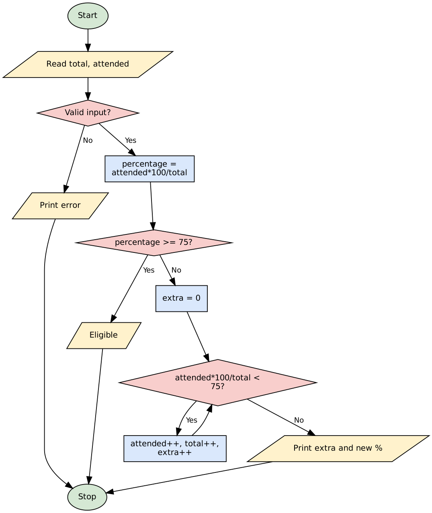
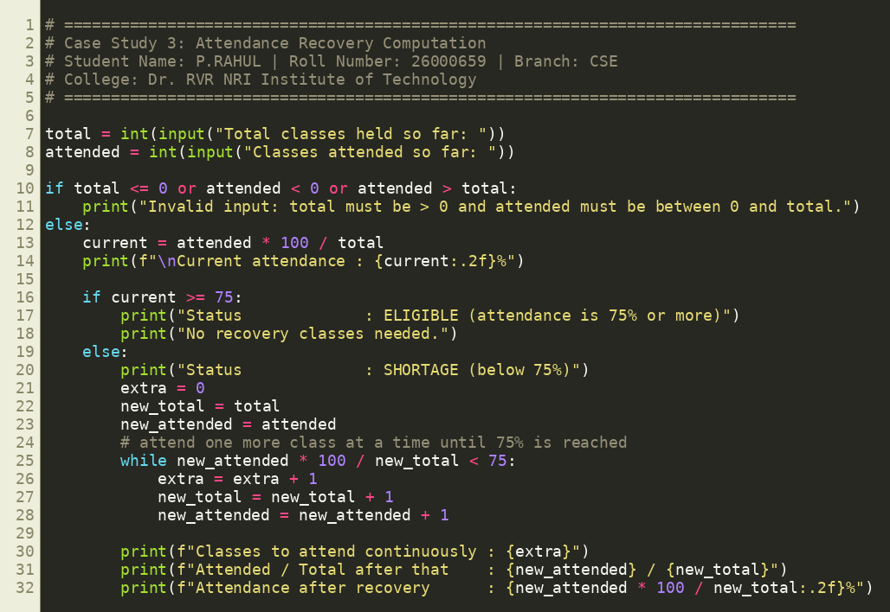
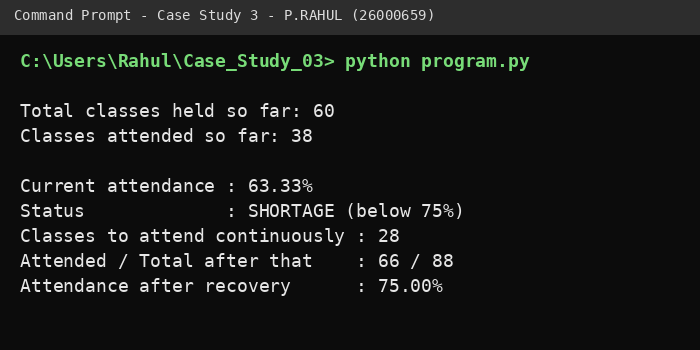

# Case Study 3: Attendance Recovery Computation

**Student:** P.RAHUL | **Roll Number:** 26000659 | **Branch:** CSE | **College:** Dr. RVR NRI Institute of Technology

## 1. Problem Statement
Students need at least 75% attendance to write exams. When attendance is lower, they want to know how many classes in a row they must attend to reach 75%.

## 2. Objectives
- Read classes held and classes attended and validate them.
- Compute current attendance percentage.
- If below 75%, use a while loop to find the minimum extra classes needed.
- Display the result.

## 3. Assumptions and Rules
- Required attendance is 75%.
- Every extra class attended increases both attended and total by 1.
- Valid input: total > 0 and 0 <= attended <= total.

## 4. Input and Output
- **Input:** total classes, attended classes (int)
- **Output:** Current %, eligibility status, extra classes needed, final %

## 5. Algorithm
1. Start.
2. Read total and attended.
3. If input is invalid, print an error and stop.
4. percentage = attended x 100 / total.
5. If percentage >= 75, print eligible and stop.
6. Otherwise repeat: attended + 1, total + 1, extra + 1 until percentage >= 75.
7. Print extra classes and the new percentage.
8. Stop.

## 6. Flowchart


## 7. Pseudocode
```text
START
  READ total, attended
  IF invalid THEN PRINT error ELSE
    pct = attended*100/total
    IF pct >= 75 THEN PRINT eligible
    ELSE
      extra = 0
      WHILE attended*100/total < 75
        attended = attended + 1 ; total = total + 1 ; extra = extra + 1
      PRINT extra
STOP
```

## 8. Python Source Code


```python
# ==============================================================================
# Case Study 3: Attendance Recovery Computation
# Student Name: P.RAHUL | Roll Number: 26000659 | Branch: CSE
# College: Dr. RVR NRI Institute of Technology
# ==============================================================================

total = int(input("Total classes held so far: "))
attended = int(input("Classes attended so far: "))

if total <= 0 or attended < 0 or attended > total:
    print("Invalid input: total must be > 0 and attended must be between 0 and total.")
else:
    current = attended * 100 / total
    print(f"\nCurrent attendance : {current:.2f}%")

    if current >= 75:
        print("Status             : ELIGIBLE (attendance is 75% or more)")
        print("No recovery classes needed.")
    else:
        print("Status             : SHORTAGE (below 75%)")
        extra = 0
        new_total = total
        new_attended = attended
        # attend one more class at a time until 75% is reached
        while new_attended * 100 / new_total < 75:
            extra = extra + 1
            new_total = new_total + 1
            new_attended = new_attended + 1

        print(f"Classes to attend continuously : {extra}")
        print(f"Attended / Total after that    : {new_attended} / {new_total}")
        print(f"Attendance after recovery      : {new_attended * 100 / new_total:.2f}%")
```

## 9. Test Cases
Outputs below are from actually running `program.py`.

**Test 1 - Shortage 38/60**

Input: `60 | 38`

```text
Total classes held so far: 60
Classes attended so far: 38

Current attendance : 63.33%
Status             : SHORTAGE (below 75%)
Classes to attend continuously : 28
Attended / Total after that    : 66 / 88
Attendance after recovery      : 75.00%
```

**Test 2 - Already eligible 45/50**

Input: `50 | 45`

```text
Total classes held so far: 50
Classes attended so far: 45

Current attendance : 90.00%
Status             : ELIGIBLE (attendance is 75% or more)
No recovery classes needed.
```

**Test 3 - Invalid input**

Input: `0 | 0`

```text
Total classes held so far: 0
Classes attended so far: 0
Invalid input: total must be > 0 and attended must be between 0 and total.
```

## 10. Program Execution and Output


Full execution log: `output.txt`.

## 11. Conclusion
A while loop is the natural tool when we do not know in advance how many repetitions are needed.

## 12. Viva Questions
1. **Q: Why a while loop and not a for loop?**  
   A: The number of extra classes is unknown until the condition becomes true.
2. **Q: Why do both total and attended increase?**  
   A: Attending a class adds one to the classes held and one to the classes attended.
3. **Q: Can attendance be recovered if attended is 0?**  
   A: Yes, but it needs 3 times the current total in extra classes; the loop handles it.
