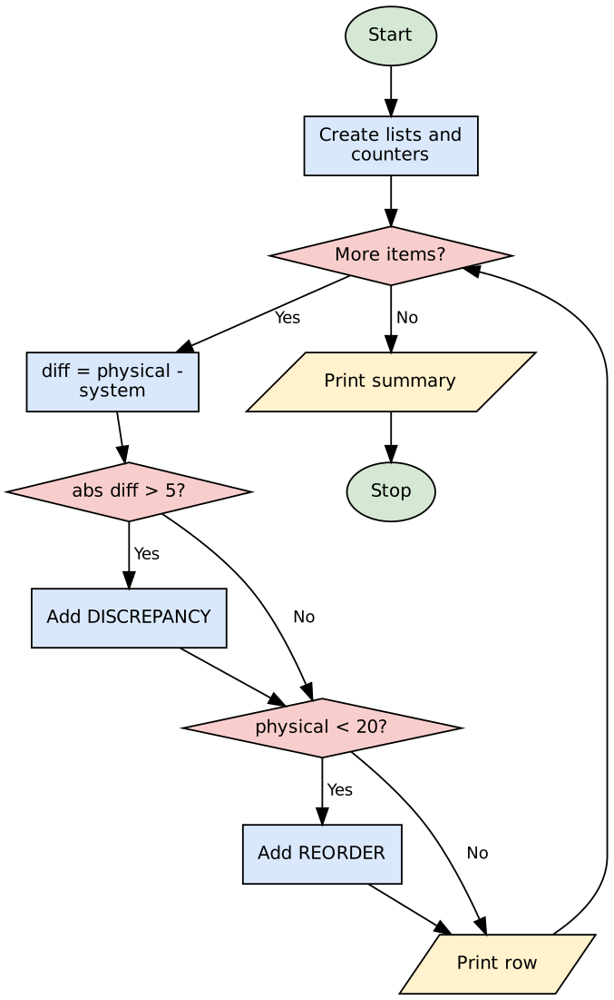
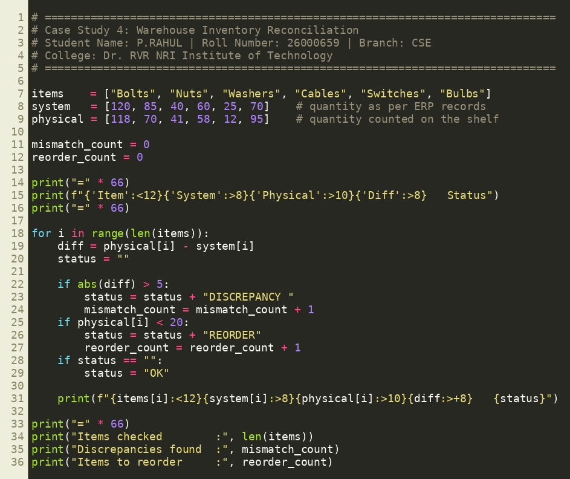
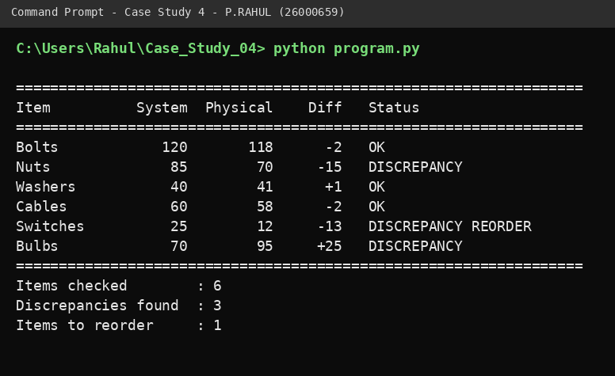

# Case Study 4: Warehouse Inventory Reconciliation

**Student:** P.RAHUL | **Roll Number:** 26000659 | **Branch:** CSE | **College:** Dr. RVR NRI Institute of Technology

## 1. Problem Statement
Stock recorded in the computer system often differs from what is physically on the shelves. The warehouse wants a program that finds big differences and items that must be reordered.

## 2. Objectives
- Store item names, system quantity and physical quantity in parallel lists.
- Compute difference = physical - system.
- Flag DISCREPANCY if |difference| > 5.
- Flag REORDER if physical stock < 20; print a summary.

## 3. Assumptions and Rules
- All three lists have the same length and the same index refers to the same item.
- DISCREPANCY: abs(diff) > 5. REORDER: physical < 20. Otherwise OK.

## 4. Input and Output
- **Input:** Lists defined in the program
- **Output:** Audit table with status for each item and summary counts

## 5. Algorithm
1. Start.
2. Create the three lists.
3. Set mismatch_count and reorder_count to 0.
4. For each index i compute diff.
5. If abs(diff) > 5 add DISCREPANCY and increase count.
6. If physical[i] < 20 add REORDER and increase count.
7. If no flag was added, status is OK.
8. Print the row; after the loop print totals.
9. Stop.

## 6. Flowchart


## 7. Pseudocode
```text
START
  items, system, physical = lists
  FOR i = 0 TO n-1
    diff = physical[i] - system[i]
    status = ""
    IF abs(diff) > 5 THEN status += "DISCREPANCY"
    IF physical[i] < 20 THEN status += "REORDER"
    IF status == "" THEN status = "OK"
    PRINT row
  PRINT counts
STOP
```

## 8. Python Source Code


```python
# ==============================================================================
# Case Study 4: Warehouse Inventory Reconciliation
# Student Name: P.RAHUL | Roll Number: 26000659 | Branch: CSE
# College: Dr. RVR NRI Institute of Technology
# ==============================================================================

items    = ["Bolts", "Nuts", "Washers", "Cables", "Switches", "Bulbs"]
system   = [120, 85, 40, 60, 25, 70]    # quantity as per ERP records
physical = [118, 70, 41, 58, 12, 95]    # quantity counted on the shelf

mismatch_count = 0
reorder_count = 0

print("=" * 66)
print(f"{'Item':<12}{'System':>8}{'Physical':>10}{'Diff':>8}   Status")
print("=" * 66)

for i in range(len(items)):
    diff = physical[i] - system[i]
    status = ""

    if abs(diff) > 5:
        status = status + "DISCREPANCY "
        mismatch_count = mismatch_count + 1
    if physical[i] < 20:
        status = status + "REORDER"
        reorder_count = reorder_count + 1
    if status == "":
        status = "OK"

    print(f"{items[i]:<12}{system[i]:>8}{physical[i]:>10}{diff:>+8}   {status}")

print("=" * 66)
print("Items checked        :", len(items))
print("Discrepancies found  :", mismatch_count)
print("Items to reorder     :", reorder_count)
```

## 9. Test Cases
Outputs below are from actually running `program.py`.

**Test 1 - Default data (6 items)**

Input: `none (data is in the program)`

```text
==================================================================
Item          System  Physical    Diff   Status
==================================================================
Bolts            120       118      -2   OK
Nuts              85        70     -15   DISCREPANCY 
Washers           40        41      +1   OK
Cables            60        58      -2   OK
Switches          25        12     -13   DISCREPANCY REORDER
Bulbs             70        95     +25   DISCREPANCY 
==================================================================
Items checked        : 6
Discrepancies found  : 3
Items to reorder     : 1
```

## 10. Program Execution and Output


Full execution log: `output.txt`.

## 11. Conclusion
Parallel lists with one loop make it easy to compare two data sources item by item.

## 12. Viva Questions
1. **Q: What are parallel lists?**  
   A: Lists where the same index belongs to the same item.
2. **Q: Why abs()?**  
   A: The difference may be positive or negative; we only care about its size.
3. **Q: Can an item have both flags?**  
   A: Yes. Switches has a discrepancy and is also below the reorder level.
