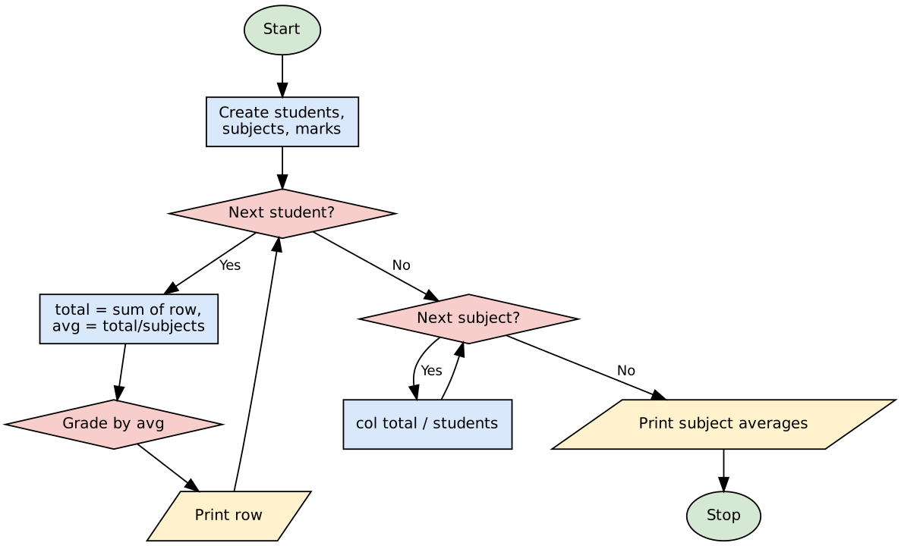
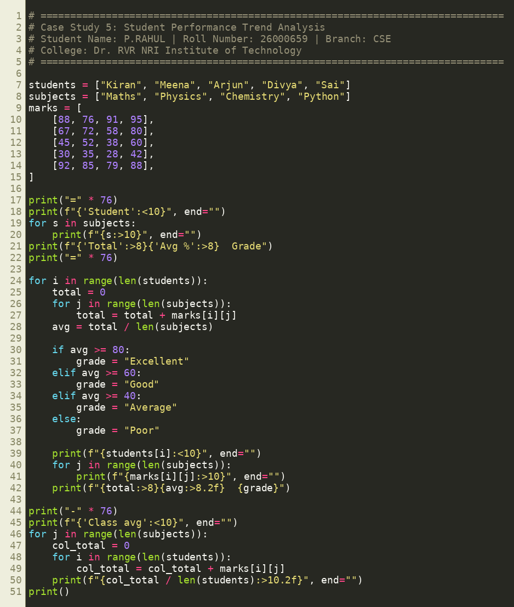
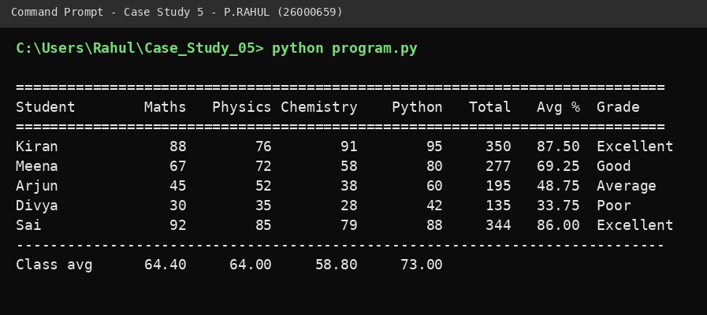

# Case Study 5: Student Performance Trend Analysis

**Student:** P.RAHUL | **Roll Number:** 26000659 | **Branch:** CSE | **College:** Dr. RVR NRI Institute of Technology

## 1. Problem Statement
Teachers need each student's total, average and grade, and also the class average for every subject, to find students and subjects that need support.

## 2. Objectives
- Store marks in a 2D list.
- Compute total and average per student.
- Assign a grade using if-elif-else.
- Compute the class average of every subject using column-wise loops.

## 3. Assumptions and Rules
- Each subject is out of 100.
- Grades: avg >= 80 Excellent; >= 60 Good; >= 40 Average; otherwise Poor.

## 4. Input and Output
- **Input:** Names, subjects and 2D marks list defined in the program
- **Output:** Table of marks, total, average, grade and subject averages

## 5. Algorithm
1. Start.
2. Create students, subjects and marks.
3. For each student (row) add up the marks and find the average.
4. Decide the grade and print the row.
5. For each subject (column) add up marks of all students and divide by number of students.
6. Print the subject averages.
7. Stop.

## 6. Flowchart


## 7. Pseudocode
```text
START
  marks = 2D list
  FOR i in students
    total = 0
    FOR j in subjects: total += marks[i][j]
    avg = total / number_of_subjects
    grade by avg ; PRINT row
  FOR j in subjects
    col = 0
    FOR i in students: col += marks[i][j]
    PRINT col / number_of_students
STOP
```

## 8. Python Source Code


```python
# ==============================================================================
# Case Study 5: Student Performance Trend Analysis
# Student Name: P.RAHUL | Roll Number: 26000659 | Branch: CSE
# College: Dr. RVR NRI Institute of Technology
# ==============================================================================

students = ["Kiran", "Meena", "Arjun", "Divya", "Sai"]
subjects = ["Maths", "Physics", "Chemistry", "Python"]
marks = [
    [88, 76, 91, 95],
    [67, 72, 58, 80],
    [45, 52, 38, 60],
    [30, 35, 28, 42],
    [92, 85, 79, 88],
]

print("=" * 76)
print(f"{'Student':<10}", end="")
for s in subjects:
    print(f"{s:>10}", end="")
print(f"{'Total':>8}{'Avg %':>8}  Grade")
print("=" * 76)

for i in range(len(students)):
    total = 0
    for j in range(len(subjects)):
        total = total + marks[i][j]
    avg = total / len(subjects)

    if avg >= 80:
        grade = "Excellent"
    elif avg >= 60:
        grade = "Good"
    elif avg >= 40:
        grade = "Average"
    else:
        grade = "Poor"

    print(f"{students[i]:<10}", end="")
    for j in range(len(subjects)):
        print(f"{marks[i][j]:>10}", end="")
    print(f"{total:>8}{avg:>8.2f}  {grade}")

print("-" * 76)
print(f"{'Class avg':<10}", end="")
for j in range(len(subjects)):
    col_total = 0
    for i in range(len(students)):
        col_total = col_total + marks[i][j]
    print(f"{col_total / len(students):>10.2f}", end="")
print()
```

## 9. Test Cases
Outputs below are from actually running `program.py`.

**Test 1 - Default data (5 students, 4 subjects)**

Input: `none (data is in the program)`

```text
============================================================================
Student        Maths   Physics Chemistry    Python   Total   Avg %  Grade
============================================================================
Kiran             88        76        91        95     350   87.50  Excellent
Meena             67        72        58        80     277   69.25  Good
Arjun             45        52        38        60     195   48.75  Average
Divya             30        35        28        42     135   33.75  Poor
Sai               92        85        79        88     344   86.00  Excellent
----------------------------------------------------------------------------
Class avg      64.40     64.00     58.80     73.00
```

## 10. Program Execution and Output


Full execution log: `output.txt`.

## 11. Conclusion
Nested loops let us read a 2D list row by row for students and column by column for subjects.

## 12. Viva Questions
1. **Q: How do you read marks of one student?**  
   A: With marks[i][j], keeping i fixed and changing j.
2. **Q: How is the subject average found?**  
   A: Keep j fixed, add marks[i][j] for all i, then divide by the number of students.
3. **Q: What if two students have equal averages?**  
   A: They get the same grade, because the grade depends only on the average.
