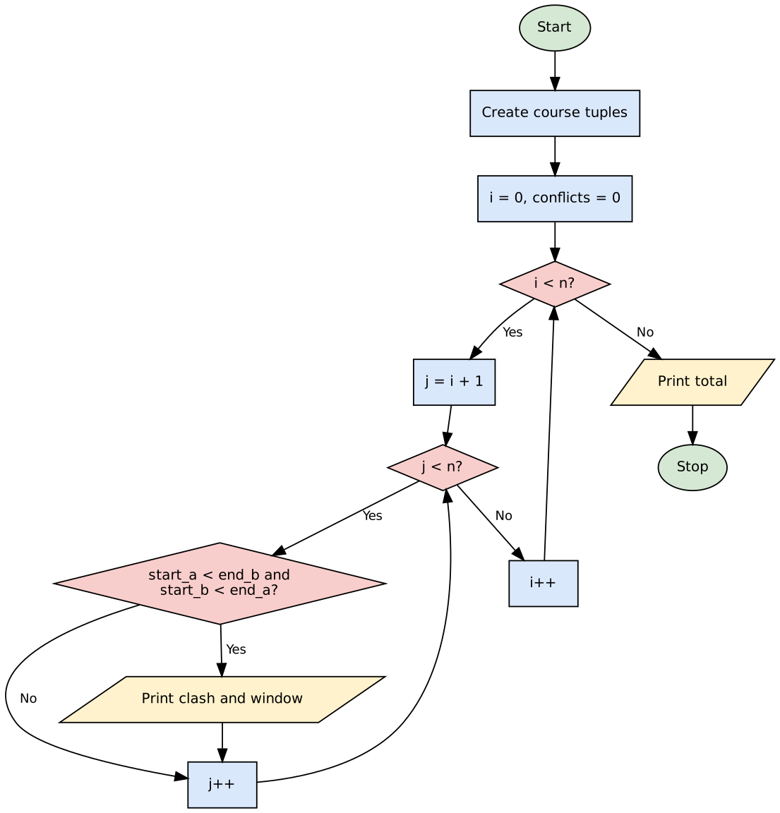
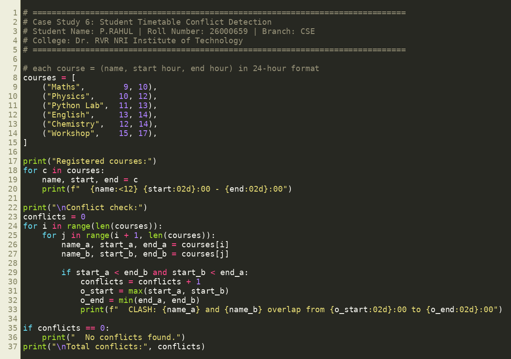
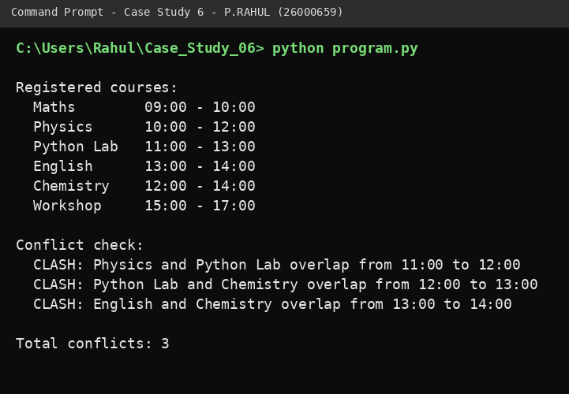

# Case Study 6: Student Timetable Conflict Detection

**Student:** P.RAHUL | **Roll Number:** 26000659 | **Branch:** CSE | **College:** Dr. RVR NRI Institute of Technology

## 1. Problem Statement
A student may register for courses whose timings overlap. The program checks every pair of courses and reports clashes along with the overlapping time.

## 2. Objectives
- Store each course as a tuple (name, start, end).
- Compare every pair of courses exactly once.
- Detect overlap and print the overlapping window.
- Count the clashes.

## 3. Assumptions and Rules
- Times are 24-hour integers.
- Two courses overlap if start_a < end_b and start_b < end_a.
- Back-to-back classes (end == start) do not clash.
- Overlap window = max(starts) to min(ends).

## 4. Input and Output
- **Input:** List of course tuples defined in the program
- **Output:** Course list, each clash with its window, total clashes

## 5. Algorithm
1. Start.
2. Create the list of tuples.
3. Print all courses.
4. For i from 0 to n-1, for j from i+1 to n-1, unpack both tuples.
5. If start_a < end_b and start_b < end_a, print the clash and add 1 to the counter.
6. Print the number of clashes.
7. Stop.

## 6. Flowchart


## 7. Pseudocode
```text
START
  courses = [(name,start,end), ...]
  conflicts = 0
  FOR i = 0 TO n-1
    FOR j = i+1 TO n-1
      IF start_i < end_j AND start_j < end_i THEN
        conflicts = conflicts + 1
        PRINT clash, max(start_i,start_j), min(end_i,end_j)
  PRINT conflicts
STOP
```

## 8. Python Source Code


```python
# ==============================================================================
# Case Study 6: Student Timetable Conflict Detection
# Student Name: P.RAHUL | Roll Number: 26000659 | Branch: CSE
# College: Dr. RVR NRI Institute of Technology
# ==============================================================================

# each course = (name, start hour, end hour) in 24-hour format
courses = [
    ("Maths",        9, 10),
    ("Physics",     10, 12),
    ("Python Lab",  11, 13),
    ("English",     13, 14),
    ("Chemistry",   12, 14),
    ("Workshop",    15, 17),
]

print("Registered courses:")
for c in courses:
    name, start, end = c
    print(f"  {name:<12} {start:02d}:00 - {end:02d}:00")

print("\nConflict check:")
conflicts = 0
for i in range(len(courses)):
    for j in range(i + 1, len(courses)):
        name_a, start_a, end_a = courses[i]
        name_b, start_b, end_b = courses[j]

        if start_a < end_b and start_b < end_a:
            conflicts = conflicts + 1
            o_start = max(start_a, start_b)
            o_end = min(end_a, end_b)
            print(f"  CLASH: {name_a} and {name_b} overlap from {o_start:02d}:00 to {o_end:02d}:00")

if conflicts == 0:
    print("  No conflicts found.")
print("\nTotal conflicts:", conflicts)
```

## 9. Test Cases
Outputs below are from actually running `program.py`.

**Test 1 - Default data (6 courses)**

Input: `none (data is in the program)`

```text
Registered courses:
  Maths        09:00 - 10:00
  Physics      10:00 - 12:00
  Python Lab   11:00 - 13:00
  English      13:00 - 14:00
  Chemistry    12:00 - 14:00
  Workshop     15:00 - 17:00

Conflict check:
  CLASH: Physics and Python Lab overlap from 11:00 to 12:00
  CLASH: Python Lab and Chemistry overlap from 12:00 to 13:00
  CLASH: English and Chemistry overlap from 13:00 to 14:00

Total conflicts: 3
```

## 10. Program Execution and Output


Full execution log: `output.txt`.

## 11. Conclusion
Tuples keep related values together and cannot be changed by mistake; the nested loop checks each pair once.

## 12. Viva Questions
1. **Q: Why tuples?**  
   A: A course record should not change after it is created, and tuples are immutable.
2. **Q: Why start j from i+1?**  
   A: So each pair is checked once and no course is compared with itself.
3. **Q: Do Maths 9-10 and Physics 10-12 clash?**  
   A: No, because one ends exactly when the other starts.
