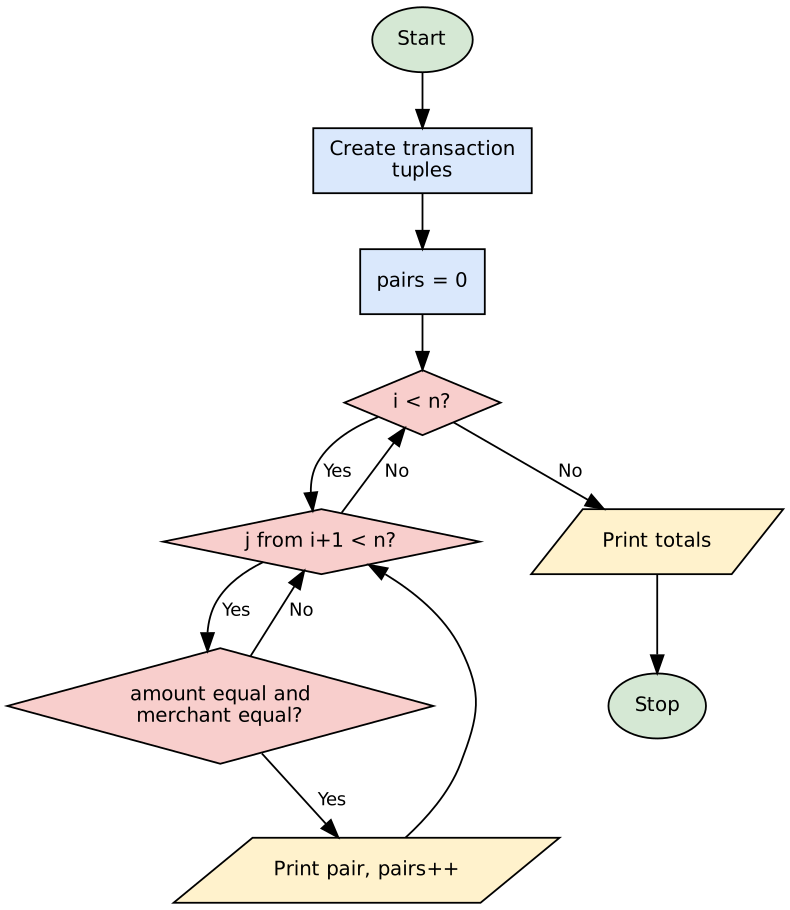
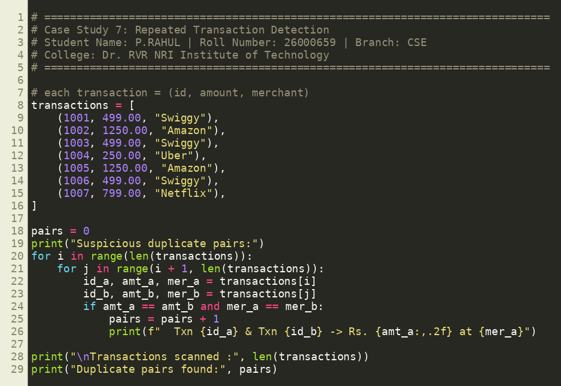
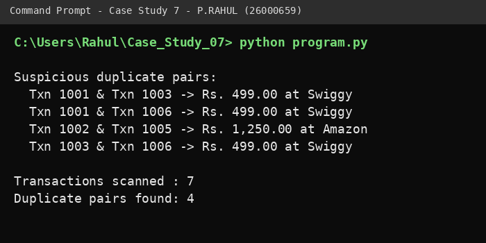

# Case Study 7: Repeated Transaction Detection

**Student:** P.RAHUL | **Roll Number:** 26000659 | **Branch:** CSE | **College:** Dr. RVR NRI Institute of Technology

## 1. Problem Statement
Banking apps sometimes charge the same amount to the same merchant more than once. The program scans all transactions and reports suspicious duplicate pairs.

## 2. Objectives
- Store transactions as tuples (id, amount, merchant).
- Compare each pair once using a triangular loop.
- Report pairs with the same amount and merchant.
- Print the number of transactions scanned and pairs found.

## 3. Assumptions and Rules
- A pair is suspicious if amounts and merchants are both equal.
- If three transactions match, three pairs are reported.

## 4. Input and Output
- **Input:** List of transaction tuples defined in the program
- **Output:** List of duplicate pairs and totals

## 5. Algorithm
1. Start.
2. Create the list of tuples.
3. pairs = 0.
4. For i from 0 to n-1 and j from i+1 to n-1, unpack both tuples.
5. If amounts are equal and merchants are equal, print the pair and increase pairs.
6. Print totals.
7. Stop.

## 6. Flowchart


## 7. Pseudocode
```text
START
  transactions = [(id,amount,merchant), ...]
  pairs = 0
  FOR i = 0 TO n-1
    FOR j = i+1 TO n-1
      IF amount_i == amount_j AND merchant_i == merchant_j THEN
        PRINT pair ; pairs = pairs + 1
  PRINT n, pairs
STOP
```

## 8. Python Source Code


```python
# ==============================================================================
# Case Study 7: Repeated Transaction Detection
# Student Name: P.RAHUL | Roll Number: 26000659 | Branch: CSE
# College: Dr. RVR NRI Institute of Technology
# ==============================================================================

# each transaction = (id, amount, merchant)
transactions = [
    (1001, 499.00, "Swiggy"),
    (1002, 1250.00, "Amazon"),
    (1003, 499.00, "Swiggy"),
    (1004, 250.00, "Uber"),
    (1005, 1250.00, "Amazon"),
    (1006, 499.00, "Swiggy"),
    (1007, 799.00, "Netflix"),
]

pairs = 0
print("Suspicious duplicate pairs:")
for i in range(len(transactions)):
    for j in range(i + 1, len(transactions)):
        id_a, amt_a, mer_a = transactions[i]
        id_b, amt_b, mer_b = transactions[j]
        if amt_a == amt_b and mer_a == mer_b:
            pairs = pairs + 1
            print(f"  Txn {id_a} & Txn {id_b} -> Rs. {amt_a:,.2f} at {mer_a}")

print("\nTransactions scanned :", len(transactions))
print("Duplicate pairs found:", pairs)
```

## 9. Test Cases
Outputs below are from actually running `program.py`.

**Test 1 - Default data (7 transactions)**

Input: `none (data is in the program)`

```text
Suspicious duplicate pairs:
  Txn 1001 & Txn 1003 -> Rs. 499.00 at Swiggy
  Txn 1001 & Txn 1006 -> Rs. 499.00 at Swiggy
  Txn 1002 & Txn 1005 -> Rs. 1,250.00 at Amazon
  Txn 1003 & Txn 1006 -> Rs. 499.00 at Swiggy

Transactions scanned : 7
Duplicate pairs found: 4
```

## 10. Program Execution and Output


Full execution log: `output.txt`.

## 11. Conclusion
A triangular nested loop compares every pair exactly once, which is what duplicate detection needs.

## 12. Viva Questions
1. **Q: Why not compare from j = 0?**  
   A: That would report each pair twice and compare a record with itself.
2. **Q: How many pairs are possible for n records?**  
   A: n(n-1)/2.
3. **Q: Why must both amount and merchant match?**  
   A: The same amount at different shops is normal; the same amount at the same shop may be a double charge.
