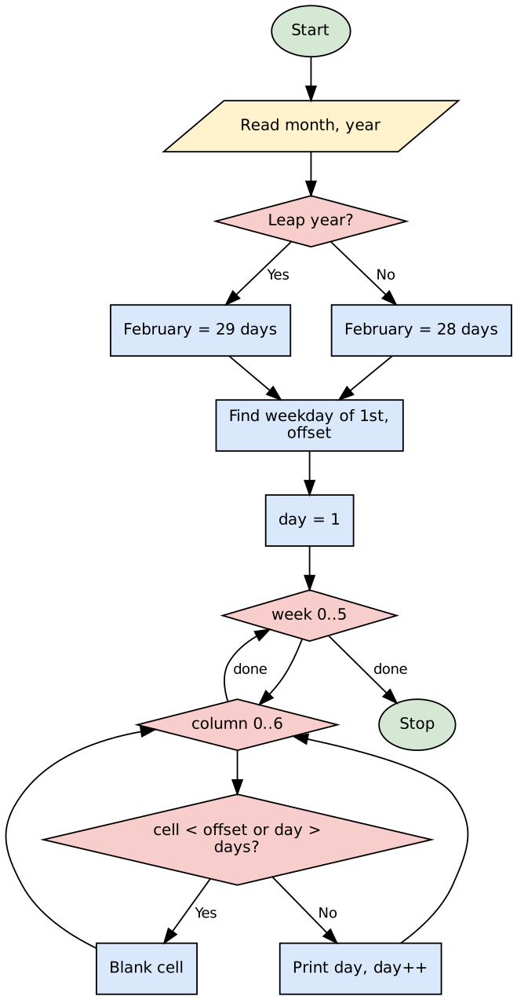
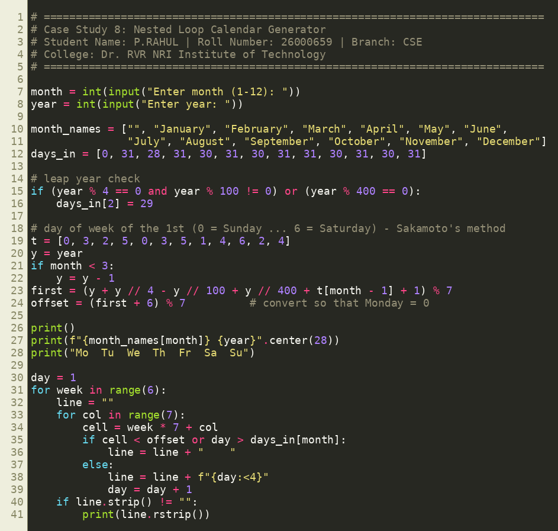
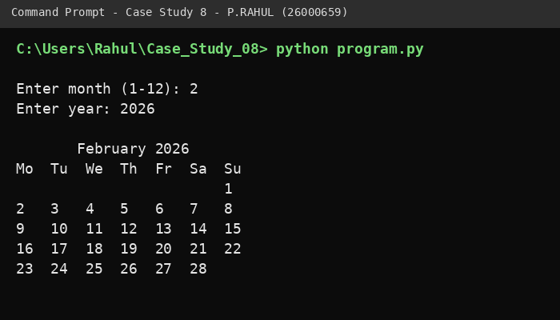

# Case Study 8: Nested Loop Calendar Generator

**Student:** P.RAHUL | **Roll Number:** 26000659 | **Branch:** CSE | **College:** Dr. RVR NRI Institute of Technology

## 1. Problem Statement
The program prints a month's calendar for any month and year without using the calendar module. It must find the weekday of the 1st and handle leap years.

## 2. Objectives
- Read month and year.
- Check whether the year is a leap year and set the days in the month.
- Find the weekday of the 1st using Sakamoto's formula.
- Print a Monday-to-Sunday grid using nested loops.

## 3. Assumptions and Rules
- Leap year: divisible by 4 and not by 100, or divisible by 400.
- The formula gives 0 = Sunday; it is shifted so that Monday = 0 for the grid.
- A month needs at most 6 weeks.

## 4. Input and Output
- **Input:** month (1-12), year (int)
- **Output:** Calendar grid with Mo-Su headings

## 5. Algorithm
1. Start.
2. Read month and year.
3. Check for leap year; if so February has 29 days.
4. Find first = weekday of the 1st with Sakamoto's formula; offset = (first + 6) % 7.
5. For week 0 to 5 and column 0 to 6: if the cell is before the offset or after the last day, print blank; else print the day and increase it.
6. Print each non-empty week.
7. Stop.

## 6. Flowchart


## 7. Pseudocode
```text
START
  READ month, year
  IF leap year THEN days[2] = 29
  first = weekday of 1st (Sakamoto) ; offset = (first + 6) mod 7
  day = 1
  FOR week = 0 TO 5
    FOR col = 0 TO 6
      IF week*7+col < offset OR day > days[month] THEN print blank
      ELSE print day ; day = day + 1
STOP
```

## 8. Python Source Code


```python
# ==============================================================================
# Case Study 8: Nested Loop Calendar Generator
# Student Name: P.RAHUL | Roll Number: 26000659 | Branch: CSE
# College: Dr. RVR NRI Institute of Technology
# ==============================================================================

month = int(input("Enter month (1-12): "))
year = int(input("Enter year: "))

month_names = ["", "January", "February", "March", "April", "May", "June",
               "July", "August", "September", "October", "November", "December"]
days_in = [0, 31, 28, 31, 30, 31, 30, 31, 31, 30, 31, 30, 31]

# leap year check
if (year % 4 == 0 and year % 100 != 0) or (year % 400 == 0):
    days_in[2] = 29

# day of week of the 1st (0 = Sunday ... 6 = Saturday) - Sakamoto's method
t = [0, 3, 2, 5, 0, 3, 5, 1, 4, 6, 2, 4]
y = year
if month < 3:
    y = y - 1
first = (y + y // 4 - y // 100 + y // 400 + t[month - 1] + 1) % 7
offset = (first + 6) % 7          # convert so that Monday = 0

print()
print(f"{month_names[month]} {year}".center(28))
print("Mo  Tu  We  Th  Fr  Sa  Su")

day = 1
for week in range(6):
    line = ""
    for col in range(7):
        cell = week * 7 + col
        if cell < offset or day > days_in[month]:
            line = line + "    "
        else:
            line = line + f"{day:<4}"
            day = day + 1
    if line.strip() != "":
        print(line.rstrip())
```

## 9. Test Cases
Outputs below are from actually running `program.py`.

**Test 1 - February 2026 (non-leap)**

Input: `2 | 2026`

```text
Enter month (1-12): 2
Enter year: 2026

       February 2026        
Mo  Tu  We  Th  Fr  Sa  Su
                        1
2   3   4   5   6   7   8
9   10  11  12  13  14  15
16  17  18  19  20  21  22
23  24  25  26  27  28
```

**Test 2 - February 2024 (leap year)**

Input: `2 | 2024`

```text
Enter month (1-12): 2
Enter year: 2024

       February 2024        
Mo  Tu  We  Th  Fr  Sa  Su
            1   2   3   4
5   6   7   8   9   10  11
12  13  14  15  16  17  18
19  20  21  22  23  24  25
26  27  28  29
```

**Test 3 - January 2027**

Input: `1 | 2027`

```text
Enter month (1-12): 1
Enter year: 2027

        January 2027        
Mo  Tu  We  Th  Fr  Sa  Su
                1   2   3
4   5   6   7   8   9   10
11  12  13  14  15  16  17
18  19  20  21  22  23  24
25  26  27  28  29  30  31
```

## 10. Program Execution and Output


Full execution log: `output.txt`.

## 11. Conclusion
Nested loops and simple integer arithmetic are enough to build a calendar grid.

## 12. Viva Questions
1. **Q: How is a leap year checked?**  
   A: Divisible by 4 and not by 100, or divisible by 400.
2. **Q: Why shift the weekday by 6?**  
   A: The formula treats Sunday as 0, but our calendar starts on Monday.
3. **Q: Why 6 rows?**  
   A: A month can spread across at most 6 calendar weeks.
