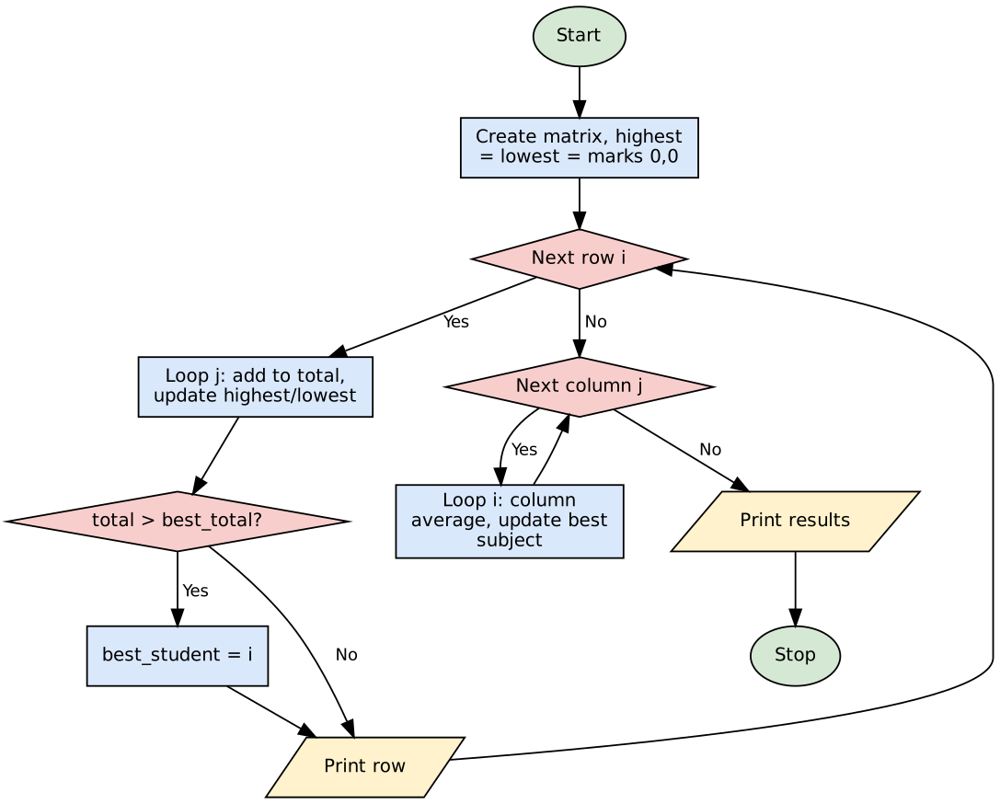
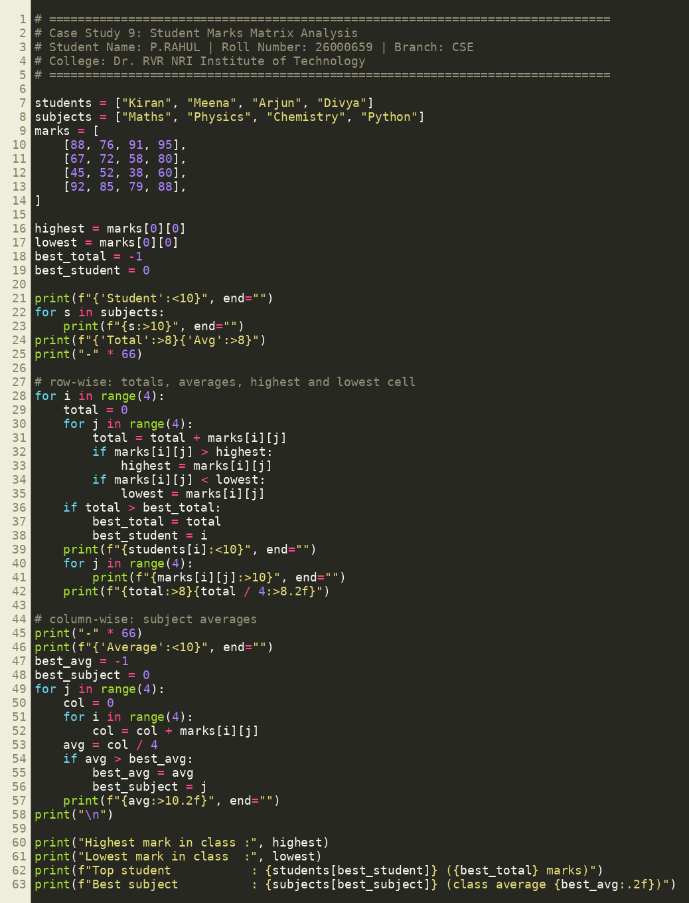
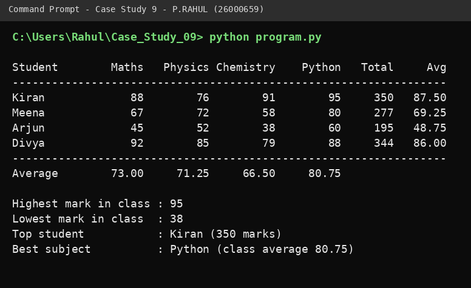

# Case Study 9: Student Marks Matrix Analysis

**Student:** P.RAHUL | **Roll Number:** 26000659 | **Branch:** CSE | **College:** Dr. RVR NRI Institute of Technology

## 1. Problem Statement
Given a 4x4 marks table, the program finds each student's total and average, each subject's class average, the highest and lowest marks, the top student and the best subject.

## 2. Objectives
- Store marks in a 2D list.
- Compute row totals and averages.
- Compute column averages.
- Find highest and lowest marks, top student and best subject using comparison loops.

## 3. Assumptions and Rules
- 4 students and 4 subjects, each mark out of 100.
- If totals tie, the first student found is reported.

## 4. Input and Output
- **Input:** Names, subjects and the marks matrix defined in the program
- **Output:** Grade book, subject averages, highest/lowest mark, top student, best subject

## 5. Algorithm
1. Start.
2. Create students, subjects and marks.
3. Set highest and lowest to marks[0][0].
4. For each row add up marks, update highest and lowest, and remember the student with the biggest total.
5. For each column find the class average and remember the best subject.
6. Print all results.
7. Stop.

## 6. Flowchart


## 7. Pseudocode
```text
START
  marks = 4x4 list
  highest = lowest = marks[0][0]
  FOR i = 0 TO 3
    total = 0
    FOR j = 0 TO 3
      total += marks[i][j] ; update highest, lowest
    IF total > best_total THEN best_total = total ; best_student = i
  FOR j = 0 TO 3
    col = SUM of marks[i][j] over i ; avg = col/4
    IF avg > best_avg THEN best_avg = avg ; best_subject = j
  PRINT all results
STOP
```

## 8. Python Source Code


```python
# ==============================================================================
# Case Study 9: Student Marks Matrix Analysis
# Student Name: P.RAHUL | Roll Number: 26000659 | Branch: CSE
# College: Dr. RVR NRI Institute of Technology
# ==============================================================================

students = ["Kiran", "Meena", "Arjun", "Divya"]
subjects = ["Maths", "Physics", "Chemistry", "Python"]
marks = [
    [88, 76, 91, 95],
    [67, 72, 58, 80],
    [45, 52, 38, 60],
    [92, 85, 79, 88],
]

highest = marks[0][0]
lowest = marks[0][0]
best_total = -1
best_student = 0

print(f"{'Student':<10}", end="")
for s in subjects:
    print(f"{s:>10}", end="")
print(f"{'Total':>8}{'Avg':>8}")
print("-" * 66)

# row-wise: totals, averages, highest and lowest cell
for i in range(4):
    total = 0
    for j in range(4):
        total = total + marks[i][j]
        if marks[i][j] > highest:
            highest = marks[i][j]
        if marks[i][j] < lowest:
            lowest = marks[i][j]
    if total > best_total:
        best_total = total
        best_student = i
    print(f"{students[i]:<10}", end="")
    for j in range(4):
        print(f"{marks[i][j]:>10}", end="")
    print(f"{total:>8}{total / 4:>8.2f}")

# column-wise: subject averages
print("-" * 66)
print(f"{'Average':<10}", end="")
best_avg = -1
best_subject = 0
for j in range(4):
    col = 0
    for i in range(4):
        col = col + marks[i][j]
    avg = col / 4
    if avg > best_avg:
        best_avg = avg
        best_subject = j
    print(f"{avg:>10.2f}", end="")
print("\n")

print("Highest mark in class :", highest)
print("Lowest mark in class  :", lowest)
print(f"Top student           : {students[best_student]} ({best_total} marks)")
print(f"Best subject          : {subjects[best_subject]} (class average {best_avg:.2f})")
```

## 9. Test Cases
Outputs below are from actually running `program.py`.

**Test 1 - Default data (4x4)**

Input: `none (data is in the program)`

```text
Student        Maths   Physics Chemistry    Python   Total     Avg
------------------------------------------------------------------
Kiran             88        76        91        95     350   87.50
Meena             67        72        58        80     277   69.25
Arjun             45        52        38        60     195   48.75
Divya             92        85        79        88     344   86.00
------------------------------------------------------------------
Average        73.00     71.25     66.50     80.75

Highest mark in class : 95
Lowest mark in class  : 38
Top student           : Kiran (350 marks)
Best subject          : Python (class average 80.75)
```

## 10. Program Execution and Output


Full execution log: `output.txt`.

## 11. Conclusion
By keeping track of the best value while looping, we can find maximum and minimum values without any built-in functions.

## 12. Viva Questions
1. **Q: How do you find the highest mark in a matrix?**  
   A: Start with marks[0][0] and compare every cell, replacing it when a bigger one is found.
2. **Q: How do you get a column average?**  
   A: Fix j, loop over i adding marks[i][j], then divide by the number of students.
3. **Q: Why start best_total at -1?**  
   A: Any real total is larger than -1, so the first student always becomes the initial best.
