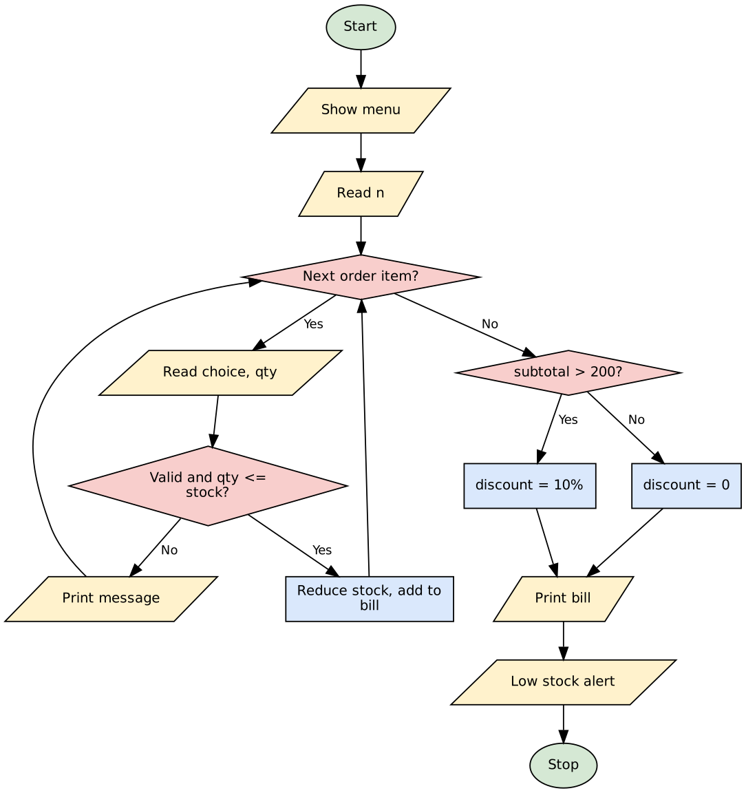
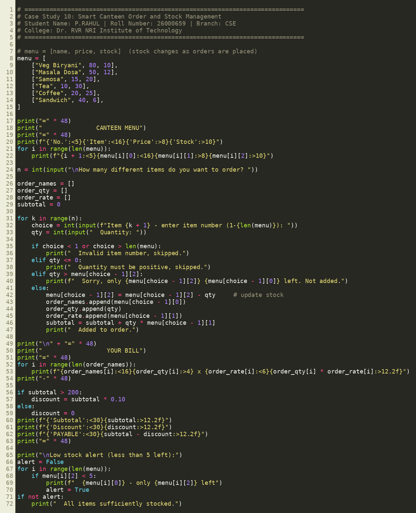
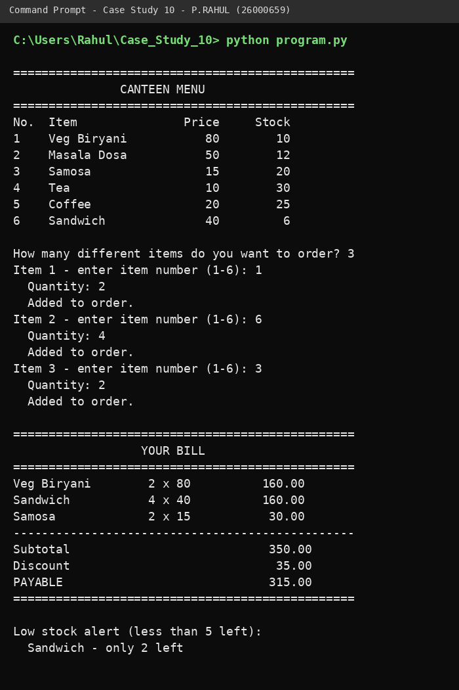

# Case Study 10: Smart Canteen Order and Stock Management

**Student:** P.RAHUL | **Roll Number:** 26000659 | **Branch:** CSE | **College:** Dr. RVR NRI Institute of Technology

## 1. Problem Statement
A canteen needs a program that shows the menu with live stock, accepts orders only if stock is available, reduces stock after each order, gives a discount on big orders, prints the bill and warns about low stock.

## 2. Objectives
- Keep the menu as a list of [name, price, stock].
- Accept item number and quantity and validate them.
- Reduce stock after a successful order.
- Apply 10% discount if subtotal > Rs. 200; print the bill.
- Print a low-stock alert for items with fewer than 5 left.

## 3. Assumptions and Rules
- Order is accepted only if quantity <= stock.
- Discount is 10% when subtotal is above Rs. 200.
- Low stock means fewer than 5 units remaining.

## 4. Input and Output
- **Input:** number of items to order; item number and quantity for each
- **Output:** Menu, order messages, itemised bill, low-stock alert

## 5. Algorithm
1. Start.
2. Create the menu list and print it.
3. Read how many items to order.
4. For each item read the number and quantity; reject invalid numbers, non-positive quantities and quantities above stock.
5. If valid, reduce stock, store the item and add to the subtotal.
6. If subtotal > 200 then discount = 10% of it.
7. Print the bill.
8. Print every item whose stock is below 5.
9. Stop.

## 6. Flowchart


## 7. Pseudocode
```text
START
  menu = [[name, price, stock], ...]
  PRINT menu ; READ n ; subtotal = 0
  FOR k = 1 TO n
    READ choice, qty
    IF choice invalid OR qty <= 0 THEN reject
    ELSE IF qty > stock THEN reject
    ELSE stock = stock - qty ; subtotal += qty*price ; save item
  IF subtotal > 200 THEN discount = 0.10*subtotal ELSE discount = 0
  PRINT bill
  FOR each item: IF stock < 5 THEN PRINT alert
STOP
```

## 8. Python Source Code


```python
# ==============================================================================
# Case Study 10: Smart Canteen Order and Stock Management
# Student Name: P.RAHUL | Roll Number: 26000659 | Branch: CSE
# College: Dr. RVR NRI Institute of Technology
# ==============================================================================

# menu = [name, price, stock]  (stock changes as orders are placed)
menu = [
    ["Veg Biryani", 80, 10],
    ["Masala Dosa", 50, 12],
    ["Samosa", 15, 20],
    ["Tea", 10, 30],
    ["Coffee", 20, 25],
    ["Sandwich", 40, 6],
]

print("=" * 48)
print("               CANTEEN MENU")
print("=" * 48)
print(f"{'No.':<5}{'Item':<16}{'Price':>8}{'Stock':>10}")
for i in range(len(menu)):
    print(f"{i + 1:<5}{menu[i][0]:<16}{menu[i][1]:>8}{menu[i][2]:>10}")

n = int(input("\nHow many different items do you want to order? "))

order_names = []
order_qty = []
order_rate = []
subtotal = 0

for k in range(n):
    choice = int(input(f"Item {k + 1} - enter item number (1-{len(menu)}): "))
    qty = int(input("  Quantity: "))

    if choice < 1 or choice > len(menu):
        print("  Invalid item number, skipped.")
    elif qty <= 0:
        print("  Quantity must be positive, skipped.")
    elif qty > menu[choice - 1][2]:
        print(f"  Sorry, only {menu[choice - 1][2]} {menu[choice - 1][0]} left. Not added.")
    else:
        menu[choice - 1][2] = menu[choice - 1][2] - qty     # update stock
        order_names.append(menu[choice - 1][0])
        order_qty.append(qty)
        order_rate.append(menu[choice - 1][1])
        subtotal = subtotal + qty * menu[choice - 1][1]
        print("  Added to order.")

print("\n" + "=" * 48)
print("                  YOUR BILL")
print("=" * 48)
for i in range(len(order_names)):
    print(f"{order_names[i]:<16}{order_qty[i]:>4} x {order_rate[i]:<6}{order_qty[i] * order_rate[i]:>12.2f}")
print("-" * 48)

if subtotal > 200:
    discount = subtotal * 0.10
else:
    discount = 0
print(f"{'Subtotal':<30}{subtotal:>12.2f}")
print(f"{'Discount':<30}{discount:>12.2f}")
print(f"{'PAYABLE':<30}{subtotal - discount:>12.2f}")
print("=" * 48)

print("\nLow stock alert (less than 5 left):")
alert = False
for i in range(len(menu)):
    if menu[i][2] < 5:
        print(f"  {menu[i][0]} - only {menu[i][2]} left")
        alert = True
if not alert:
    print("  All items sufficiently stocked.")
```

## 9. Test Cases
Outputs below are from actually running `program.py`.

**Test 1 - Big order with discount**

Input: `3 | 1 | 2 | 6 | 4 | 3 | 2`

```text
================================================
               CANTEEN MENU
================================================
No.  Item               Price     Stock
1    Veg Biryani           80        10
2    Masala Dosa           50        12
3    Samosa                15        20
4    Tea                   10        30
5    Coffee                20        25
6    Sandwich              40         6

How many different items do you want to order? 3
Item 1 - enter item number (1-6): 1
  Quantity: 2
  Added to order.
Item 2 - enter item number (1-6): 6
  Quantity: 4
  Added to order.
Item 3 - enter item number (1-6): 3
  Quantity: 2
  Added to order.

================================================
                  YOUR BILL
================================================
Veg Biryani        2 x 80          160.00
Sandwich           4 x 40          160.00
Samosa             2 x 15           30.00
------------------------------------------------
Subtotal                            350.00
Discount                             35.00
PAYABLE                             315.00
================================================

Low stock alert (less than 5 left):
  Sandwich - only 2 left
```

**Test 2 - Insufficient stock**

Input: `1 | 6 | 10`

```text
================================================
               CANTEEN MENU
================================================
No.  Item               Price     Stock
1    Veg Biryani           80        10
2    Masala Dosa           50        12
3    Samosa                15        20
4    Tea                   10        30
5    Coffee                20        25
6    Sandwich              40         6

How many different items do you want to order? 1
Item 1 - enter item number (1-6): 6
  Quantity: 10
  Sorry, only 6 Sandwich left. Not added.

================================================
                  YOUR BILL
================================================
------------------------------------------------
Subtotal                              0.00
Discount                              0.00
PAYABLE                               0.00
================================================

Low stock alert (less than 5 left):
  All items sufficiently stocked.
```

**Test 3 - Small order, no discount**

Input: `2 | 4 | 2 | 3 | 1`

```text
================================================
               CANTEEN MENU
================================================
No.  Item               Price     Stock
1    Veg Biryani           80        10
2    Masala Dosa           50        12
3    Samosa                15        20
4    Tea                   10        30
5    Coffee                20        25
6    Sandwich              40         6

How many different items do you want to order? 2
Item 1 - enter item number (1-6): 4
  Quantity: 2
  Added to order.
Item 2 - enter item number (1-6): 3
  Quantity: 1
  Added to order.

================================================
                  YOUR BILL
================================================
Tea                2 x 10           20.00
Samosa             1 x 15           15.00
------------------------------------------------
Subtotal                             35.00
Discount                              0.00
PAYABLE                              35.00
================================================

Low stock alert (less than 5 left):
  All items sufficiently stocked.
```

## 10. Program Execution and Output


Full execution log: `output.txt`.

## 11. Conclusion
A list of lists lets us change stock values while the program runs, and simple if-else checks prevent overselling.

## 12. Viva Questions
1. **Q: Why a list of lists and not a list of tuples?**  
   A: Stock must change after every order and tuples cannot be modified.
2. **Q: How is overselling prevented?**  
   A: The order is accepted only when quantity <= available stock.
3. **Q: When does the discount apply?**  
   A: When the subtotal is more than Rs. 200; then 10% is deducted.
